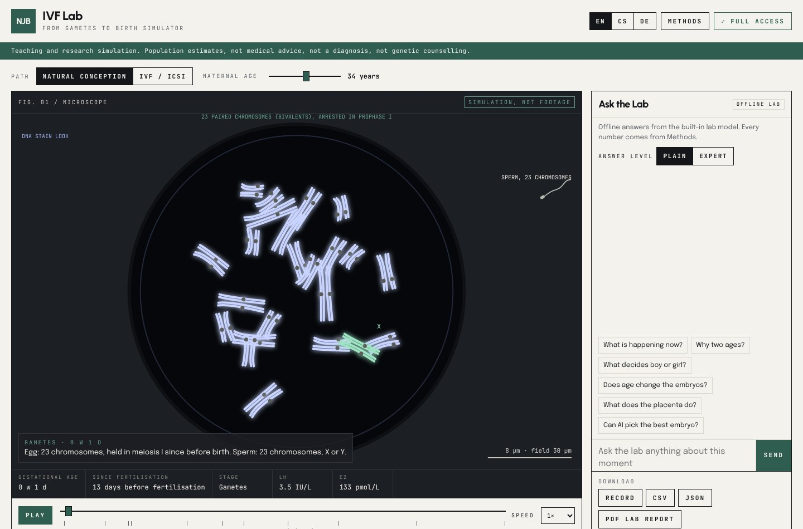
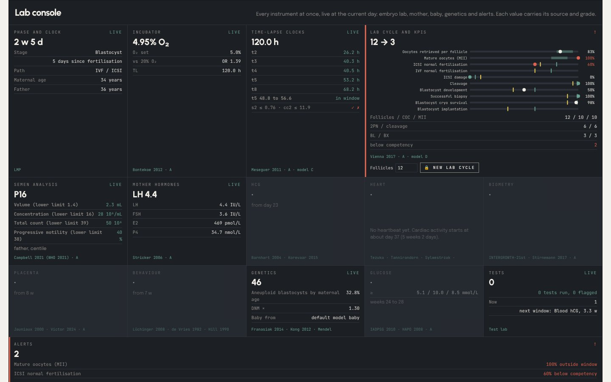
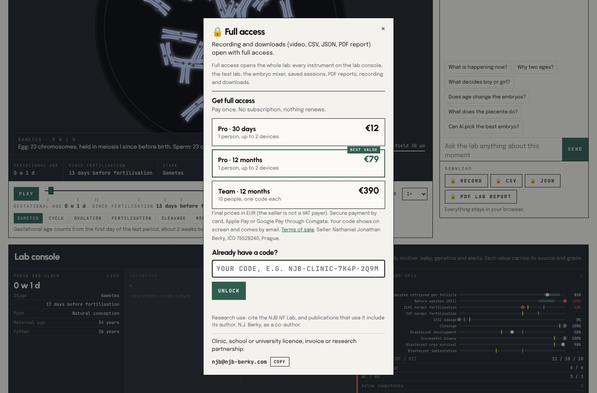
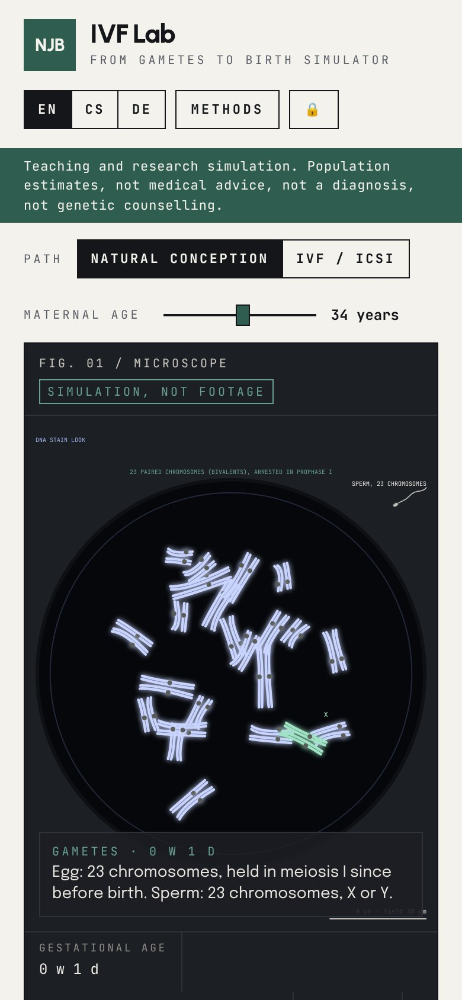

# NJB IVF Lab · From Gametes to Birth Simulator

**Live:** https://ivf-lab.njb-berky.com/ (English · Čeština · Deutsch)

A teaching and research simulation that follows one pregnancy from egg and sperm, through the IVF laboratory, to birth. Built for embryology and medical students, clinic teams and researchers. One master clock runs from day 0 (the first day of the last period) to week 40, and every panel reads the same clock: the microscope, the time-lapse incubator, the ultrasound screen, the hormone curves, the chromosomes and the lab console.

Every value is a population median or a consensus timing with its source, and every parameter carries an evidence grade (A to D). Where no verified source exists, the value is a model setting marked grade D, or nothing is drawn.

> Not medical advice. Values are population estimates and the ultrasound image is generated, not a patient scan. The Lab does not describe, assess or predict any real patient, embryo or pregnancy.

## What it does

- **Two paths on one clock:** natural conception, or IVF / ICSI with stimulation and egg retrieval, ICSI, a time-lapse incubator, blastocyst grading, optional PGT-A, single embryo transfer and beta-hCG.
- **Microscope and development atlas:** gametes, fertilisation, the first cell divisions and the blastocyst, then every Carnegie stage and every fetal week. Click a stage and the whole Lab jumps there.
- **Baby monitor:** the simulated baby on a live ultrasound screen from the first heartbeat to birth, with sizes, heart rate and movement from the sources, and a heartbeat you can listen to.
- **Lab console:** every instrument live at the current day (embryo lab, mother, baby, genetics, alerts), plus a catalogue of everything you can see, test and monitor, each a window on the timeline.
- **Test lab:** real prenatal and fertility tests (hCG, dating scan, nuchal translucency, NIPT, CVS, amniocentesis, anatomy scan, glucose tolerance test, growth scan, CTG, blood group, semen analysis and more) that you can run at any week. Results stay on the timeline.
- **Embryo mixer:** combine two parents and see what each simulated embryo carries: chromosomes by maternal age, Mendelian conditions and blood group.
- **Ask the Lab:** questions about the current moment, answered from the built-in lab model at a plain or expert level, with every number taken from Methods.
- **Lab log and reports:** every action is logged with time and gestational day; sessions can be saved and loaded, recorded, and exported as CSV, JSON or a PDF lab report.
- **Three languages:** the whole Lab, its methods and its exports run fully in EN, CS and DE.

## Access

| | Public | Full access (time-limited code) |
|---|---|---|
| The whole timeline, microscope, atlas, ultrasound and curves, all three languages | ✓ | ✓ |
| Natural and IVF / ICSI paths, lab console, Ask the Lab | ✓ | ✓ |
| Test lab and embryo mixer | | ✓ |
| New lab cycles with your own follicle count | | ✓ |
| Recording, downloads (CSV, JSON, PDF lab report) | | ✓ |
| Saving and loading sessions | | ✓ |

Access codes go to clinics, universities, courses and research groups. They are time-limited and device-limited.

## Research and teaching use

Teaching and research access is free for universities and research groups. In return:

- cite the NJB IVF Lab (see [Cite](#cite)), and
- publications that use the Lab include its author, N.J. Berky, as a co-author.

Access codes, clinic training, collaborations and validation studies: **njb@njb-berky.com**

## Ethics and law

Chromosomal sex is shown as biology only and cannot be chosen in the Lab. Sex selection for non-medical reasons is prohibited in Germany (ESchG § 3), Switzerland (FMedG Art. 5a) and the Czech Republic (Act No. 373/2011 Coll., § 5), and the Lab follows that. The embryo mixer does not predict IQ, height, looks or personality: the European Society of Human Genetics judges polygenic embryo scores unproven and unethical (Forzano et al. 2022).

## Science basis (selection)

- Alpha Scientists in Reproductive Medicine and ESHRE Special Interest Group of Embryology. The Istanbul consensus workshop on embryo assessment. *Hum Reprod* 2011;26(6):1270-83. Update: Coticchio G et al. *Hum Reprod* 2025;40(6):989-1035. doi:10.1093/humrep/deaf021
- Meseguer M et al. The use of morphokinetics as a predictor of embryo implantation. *Hum Reprod* 2011;26(10):2658-71. doi:10.1093/humrep/der256
- Gardner DK et al. Blastocyst score affects implantation and pregnancy outcome: towards a single blastocyst transfer. *Fertil Steril* 2000;73(6):1155-8. doi:10.1016/s0015-0282(00)00518-5
- ESHRE SIG Embryology and Alpha Scientists. The Vienna consensus: ART laboratory performance indicators. *Reprod Biomed Online* 2017;35(5):494-510. doi:10.1016/j.rbmo.2017.06.015
- Franasiak JM et al. The nature of aneuploidy with increasing age of the female partner: 15,169 trophectoderm biopsies. *Fertil Steril* 2014;101(3):656-663.e1. doi:10.1016/j.fertnstert.2013.11.004
- Wilcox AJ, Baird DD, Weinberg CR. Time of implantation of the conceptus and loss of pregnancy. *N Engl J Med* 1999;340(23):1796-9. doi:10.1056/NEJM199906103402304
- Papageorghiou AT et al. International standards for fetal growth (INTERGROWTH-21st). *Lancet* 2014;384(9946):869-79. doi:10.1016/S0140-6736(14)61490-2

The full reference list, with the value, range, source and evidence grade of every parameter, is in the Lab under **Methods**.

## How it is built

- Single-page web app; the full version ships encrypted (AES-256-GCM) and opens only with a valid code.
- Cloudflare Pages for the site, Cloudflare Workers for the access API, D1 (EU jurisdiction) for codes.
- Privacy: the simulation, its log and its exports run in the browser. Nothing about a session leaves the browser.

The source code is private.

## Cite

> Berky, N.J. (2026). NJB IVF Lab: From Gametes to Birth Simulator, version 0.5.0 [Software]. https://ivf-lab.njb-berky.com/

See also [CITATION.cff](CITATION.cff).

## Contact

Access codes, clinic training, collaboration and courses: **njb@njb-berky.com** · https://njb-berky.com/lab

Also by the same author: the NJB Brain Lab, a learner brain simulator for education research: https://github.com/NathBerky/brain-lab/

---

made by N.J. Berky · AI architect · Prague · Zürich

© 2026 N.J. Berky. All rights reserved.
